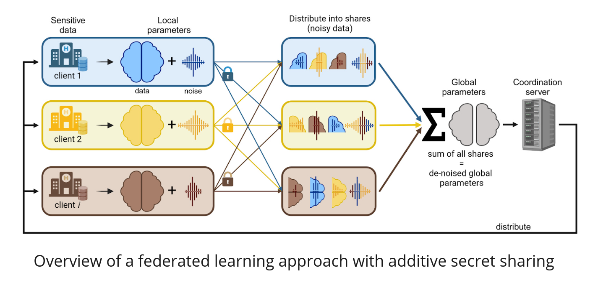
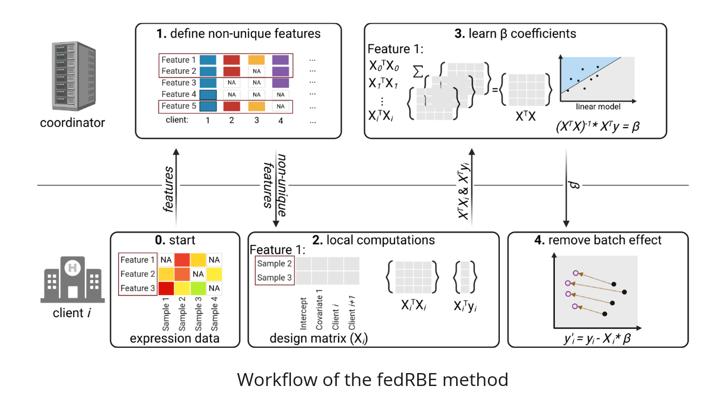
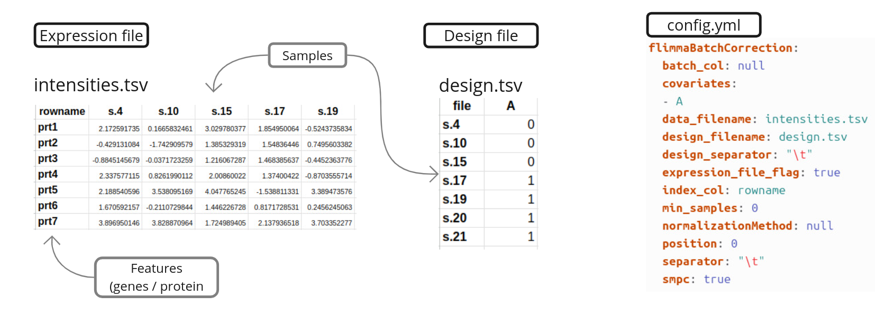

<table>
  <tr>
    <td><a href="https://freddsle.github.io/fedRBE/docs/how_to_guide.html"></a></td>
    <td><a href="https://freddsle.github.io/fedRBE/"></a></td>
    <td><a href="https://github.com/Freddsle/fedRBE/"></a></td>
    <td><a href="https://featurecloud.ai/app/fedrbe"></a></td>
  </tr>
</table>


# Federated limma remove batch effect (fedRBE) <!-- omit in toc -->

[](https://github.com/Freddsle/fedRBE/blob/main/LICENSE)
[](https://arxiv.org/abs/2412.05894)

---

## Table of Contents <!-- omit in toc -->
- [Architecture overview](#architecture-overview)
- [Installation](#installation)
  - [Prerequisites](#prerequisites)
  - [Clone the repository](#clone-the-repository)
- [Usage](#usage)
  - [Quick start](#quick-start)
  - [Glossary \& further resources](#glossary--further-resources)
  - [Input and Output](#input-and-output)
  - [Configuration](#configuration)
- [Reproducing the paper](#reproducing-the-paper)
- [Single-machine simulation](#single-machine-simulation)
  - [Option 1: Using the helper python script](#option-1-using-the-helper-python-script)
  - [Option 2: Using the FeatureCloud Simulation framework](#option-2-using-the-featurecloud-simulation-framework)
- [Troubleshooting](#troubleshooting)
- [License](#license)
- [How to cite](#how-to-cite)
- [Contact information](#contact-information)


---

## Architecture overview

The **Federated Limma Remove Batch Effect (fedRBE)** app runs limma's `removeBatchEffect` in a [FeatureCloud](https://featurecloud.ai/) workflow. Raw data stays at each client site, while Secure Multiparty Computation (SMPC) aggregates the summary statistics needed for batch effect correction.

fedRBE allows multiple participants to collaboratively remove batch effects from their data without sharing raw data, ensuring privacy. It effectively eliminates non-biological variations arising from different sources such as labs, time points, or technologies, using limma’s `removeBatchEffect`. The tool supports various data formats and seamlessly integrates with the FeatureCloud platform for streamlined workflow management.
<p align="center">
   
   <br>
   <em>fedRBE app states. <a href="https://arxiv.org/abs/2412.05894" target="_blank">Source: ArXiv 2412.05894</a></em>
</p>


The repository has two main parts:
- **fedRBE app**: `batchcorrection/` contains the FeatureCloud app.
- **Reproducibility analysis**: `evaluation_data/`, `evaluation/`, and analysis folders reproduce the results from the [ArXiv preprint](https://arxiv.org/abs/2412.05894).


<p align="center">
   
   <br>
   <em>fedRBE architecture. <a href="https://arxiv.org/abs/2412.05894" target="_blank">Source: ArXiv 2412.05894</a></em>
</p>


The app is available on [FeatureCloud](https://featurecloud.ai/app/fedrbe). For setup, workflow, and implementation details, see the [How To Guide](https://freddsle.github.io/fedRBE/docs/how_to_guide.html) and the [app README](https://freddsle.github.io/fedRBE/batchcorrection/).

---
## Installation

### Prerequisites

Install:
1. **Docker**: [Installation Instructions](https://www.docker.com/get-started)
2. **Either** [pixi](https://pixi.sh) (recommended, Linux x86-64), Conda or Mamba for `environment.yml`, **or** separate Python 3.8+ and R 4.0+ installations.

Additional requirements depend on the use case:
- **Running fedRBE in a federated manner via the FeatureCloud platform**: FeatureCloud account
- **Reproducing the paper**: Git LFS and R dependencies from `requirements_r.txt`

For Windows users, we recommend using [WSL](https://docs.docker.com/desktop/features/wsl/).

### Clone the repository

For local simulations or reproduction:

```bash
git clone https://github.com/Freddsle/fedRBE.git
cd fedRBE
```

Recommended: pixi installs one locked Python and R environment (`pixi.toml`,
`pixi.lock`) for all evaluation code and notebooks:

```bash
pixi install --locked
pixi run setup-affymetrix   # once, only for raw Affymetrix CEL preprocessing
pixi run jupyter lab        # notebooks use the `python3` and `ir` kernels
```

Run scripts with `pixi run python ...` or `pixi run Rscript ...`, or activate the
environment with `pixi shell`. `setup-affymetrix` downloads the Affymetrix CDF packages
and rebuilds `preprocessCore` without threading for `affy::rma()`.

Or choose Conda/Mamba:

```bash
conda env create -f environment.yml
conda activate fedRBE
```

Mamba can use the same `environment.yml`. The file pins
`conda-forge::openblas=0.3.3` to avoid `pthread_create()` failures in
`affy::rma()` for conda environments. If that older build cannot be resolved
for your platform, use the `preprocessCore` source-install command in the
reproduction guide.

Or separate Python and R installations:

```bash
python3 -m venv fedrbe_env
source fedrbe_env/bin/activate   # on Windows: fedrbe_env\Scripts\activate
pip install -r requirements.txt
```

Without pixi, install the R packages from `requirements_r.txt` for full paper
reproduction; see [Reproduce the fedRBE Preprint](./docs/reproduce.md#setup-steps) for
the exact CRAN, Bioconductor, and `preprocessCore` installation commands.

---

## Usage

### Quick start
After [installation](#installation), run the bundled simulated experiment:
```bash
python3 run_sample_experiment.py
```
For other usage modes:
1. Multi-machine collaboration: [How To Guide](https://freddsle.github.io/fedRBE/docs/how_to_guide.html)
2. Local FeatureCloud test environment: [Local Test Guide](https://freddsle.github.io/fedRBE/docs/local_test.html)

---

### Glossary & further resources

- **FeatureCloud**: A platform enabling federated analyses. [FeatureCloud docs](https://featurecloud.ai/)
- **limma**: R package providing `removeBatchEffect` and differential expression analysis.

For advanced configuration details, see the
[app README](https://freddsle.github.io/fedRBE/batchcorrection/#configuration-configyml) and the [ArXiv preprint](https://doi.org/10.48550/arXiv.2412.05894).

If you encounter errors:
- Check the logs for error messages.
- Revisit the [app README](https://freddsle.github.io/fedRBE/batchcorrection/).
- Open an issue on the [GitHub repository](https://github.com/Freddsle/fedRBE).

---


### Input and Output

Provide a data file, `config.yml`, and an optional design file with covariates;
see [file preparation](https://freddsle.github.io/fedRBE/docs/how_to_guide.html#file-preparation).

<p align="center">
   
   <br>
   <em>Input files required for fedRBE.</em>
</p>

Output files include:
- **Corrected Data**: Batch-corrected features (rows) x samples (columns), whatever the input orientation.
- **Corrected Data with covariates**: The same, with the covariates appended unchanged as rows.
- **Report**: A summary of the correction process and results.

---


### Configuration

`config.yml` controls data formats, normalization, SMPC, privacy thresholds, and batch settings.

**Example `config.yml`**:

   ```yaml
   flimmaBatchCorrection:
      data_filename: "expression_data_client1.csv"
      expression_file_flag: True
      index_col: "GeneIDs"
      covariates: ["Pyr"]
      separator: ","
      design_separator: ","
      normalizationMethod: "log2(x+1)"
      smpc: True
      min_samples: 5
      position: 1
      reference_batch: ""
   ```

See the [full configuration reference](https://freddsle.github.io/fedRBE/batchcorrection/#configuration-configyml).

---

## Reproducing the paper

Use the [Reproducibility Guide](https://freddsle.github.io/fedRBE/docs/reproduce.html)
to run the code and data analyses from the [ArXiv preprint](https://arxiv.org/abs/2412.05894).


---

## Single-machine simulation

To simulate a federated workflow on a single machine using provided sample data:

### Option 1: Using the helper python script 
For sample data, use the [Quick Start](#quick-start).

### Option 2: Using the FeatureCloud Simulation framework
Use the [Local Test Guide](https://freddsle.github.io/fedRBE/docs/local_test.html) to run a simulation with correctly formatted test data.

---

## Troubleshooting

- **Missing Files**: Ensure `config.yml` and data files are in the correct directory.
- **Incorrect Format**: Verify `expression_file_flag` and `index_col` settings in `config.yml`.
- **No Output Produced**: Check the logs for error messages.
- **Errors with Test runs**: Ensure there are no leftover running Docker containers. Restart Docker or the system if necessary.

_For detailed troubleshooting tips, refer to the [How To Guide](https://freddsle.github.io/fedRBE/docs/how_to_guide.html#troubleshooting-tips)._


## License

This project is licensed under the [Apache License 2.0](LICENSE).

---

## How to cite

If you use `fedRBE` in your research, please cite our [ArXiv preprint](https://arxiv.org/abs/2412.05894):

 > Burankova, Y., Klemm, J., Lohmann, J.J., Taheri, A., Probul, N., Baumbach, J. and Zolotareva, O., 2024. FedRBE--a decentralized privacy-preserving federated batch effect correction tool for omics data based on limma. arXiv preprint arXiv:2412.05894.

   ```bibtex
   @misc{burankova2024fedrbedecentralizedprivacypreserving,
         title={FedRBE -- a decentralized privacy-preserving federated batch effect correction tool for omics data based on limma}, 
         author={Yuliya Burankova and Julian Klemm and Jens J. G. Lohmann and Ahmad Taheri and Niklas Probul and Jan Baumbach and Olga Zolotareva},
         year={2024},
         eprint={2412.05894},
         archivePrefix={arXiv},
         primaryClass={q-bio.QM},
         url={https://arxiv.org/abs/2412.05894}, 
   }
   ```

---

## Contact information

For questions, issues, or support, please open an issue on the [GitHub repository](https://github.com/Freddsle/fedRBE).
