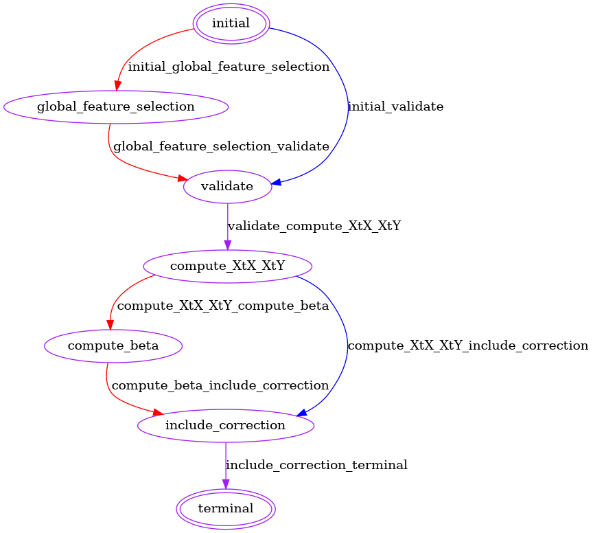

<table>
  <tr>
    <td><a href="https://freddsle.github.io/fedRBE/docs/how_to_guide.html"></a></td>
    <td><a href="https://freddsle.github.io/fedRBE/"></a></td>
    <td><a href="https://github.com/Freddsle/fedRBE/"></a></td>
    <td><a href="https://featurecloud.ai/app/fedrbe"></a></td>
  </tr>
</table>

# fedRBE - FeatureCloud <!-- omit in toc -->

**A federated implementation of the limma `removeBatchEffect` method.**
Supports log scaling, multiple batches per client, and SMPC.

- **Open Source & Free**: [GitHub Repository](https://github.com/Freddsle/fedRBE/tree/main/batchcorrection)  
- **Federated Privacy-preserving tool**: Based on [FeatureCloud](https://featurecloud.ai/app/fedrbe) platform  
- **Preprint**: [ArXiv](https://doi.org/10.48550/arXiv.2412.05894)
- **Full Documentation**: [GitHub Pages](https://freddsle.github.io/fedRBE/)

---

## Table of Contents <!-- omit in toc -->
- [Overview](#overview)
- [Prerequisites and setup](#prerequisites-and-setup)
- [Usage](#usage)
  - [Simulating a federated workflow locally (No login required)](#simulating-a-federated-workflow-locally-no-login-required)
  - [Running a true federated workflow (Login required)](#running-a-true-federated-workflow-login-required)
- [Input requirements](#input-requirements)
- [Outputs](#outputs)
- [Configuration (config.yml)](#configuration-configyml)
- [Protocol phases](#protocol-phases)
- [Additional resources](#additional-resources)
- [License](#license)
- [How to cite](#how-to-cite)

---

## Overview
fedRBE corrects distributed omics data using limma's `removeBatchEffect()` method.
Raw data stays at each site; only summary statistics are shared, with optional
secure multi-party computation (SMPC). Two modes are available:

* [Federated mode](#running-a-true-federated-workflow-login-required): Collaborate across sites; registration required.

* [Simulation mode](#simulating-a-federated-workflow-locally-no-login-required): Simulate clients locally; no registration required.

For advanced parameters, see [Configuration](#configuration-configyml).

---

## Prerequisites and setup

Install:
1. **Docker** is installed ([FeatureCloud prerequisites](https://featurecloud.ai/developers)).
1. **Python3** is installed. [Installation Instructions](https://www.python.org/doc/).
1. **FeatureCloud CLI**:
   ```bash
   pip install featurecloud
   featurecloud controller start
   ```
1. **App Image**:  
   - For linux/amd64:
     ```bash
     # pull the pre-built image
     featurecloud app download featurecloud.ai/bcorrect
     ```
     or directly via Docker
     ```bash
     docker pull featurecloud.ai/bcorrect:latest
     ```
   - For ARM (e.g., Mac M-series) or other platforms incompatible with linux/amd64,
     build locally from the checkout:
     ```bash
     cd batchcorrection
     docker build . -t featurecloud.ai/bcorrect:latest
     ```

---

## Usage

### Simulating a federated workflow locally (No login required)
1. **Clone the full repository and enter it**:
   ```bash
   git clone https://github.com/Freddsle/fedRBE.git
   cd fedRBE
   ```

2. **Run a Sample Experiment**:
   ```bash
   python3 ./run_sample_experiment.py
   ```
  The script prints the browser link for the local run.

### Running a true federated workflow (Login required)
1. **Create a Project** in [FeatureCloud](https://featurecloud.ai/projects) and invite at least 3 clients.
2. **Clients Join with Tokens** provided by the coordinator.
3. **Each Client** uploads their data and `config.yml` to their local FeatureCloud instance.
4. **Start the Project**: `fedRBE` runs securely, never sharing raw data.

A FeatureCloud account restricts access to invited participants. See the
[How To Guide](https://freddsle.github.io/fedRBE/docs/how_to_guide.html) for setup.

---

## Input requirements
- **Data File**: CSV/TSV, samples × features or features × samples.
- **`config.yml`**: Configuration file controlling formats, normalization, and additional parameters.
- **Optional Design Matrix**: CSV/TSV with covariates (samples x covariates).

For details, see the [Configuration](#configuration-configyml) section.

---

## Outputs
After completion, each client receives:
- **`full_corrected_data.csv`**: Batch corrected features with the design covariates merged in.
- **`only_batch_corrected_data.csv`**: Batch-corrected features.
- **`report.txt`**: The client name, the batch coefficients used for the correction and the
  design matrix. Features masked for privacy are listed in the app log.

The coordinator additionally receives the files needed to correct new batches later on,
without another run (see [Correcting new batches](#correcting-new-batches-after-a-fedrbe-run)):
- **`batch_coefficients.csv`**: The batch coefficients per hashed feature name.
- **`training_level.csv`**: Per hashed feature name, the level the corrected data sits at.
- **`training_level_info.yml`**: The normalization of the run, whether covariates were used,
  the number of batches and the file separator.

**Note**: Output files use the same `separator` defined in `config.yml`. Both CSV files are
features (rows) x samples (columns) whatever the input orientation; `full_corrected_data.csv`
appends the covariates as rows. Values masked for privacy (fewer finite values than the
effective `min_samples` in a batch or on the client) are exported as empty cells.
Features available in fewer than `min_clients` (default: three) clients are omitted.

---

## Configuration (config.yml)
Upload a `config.yml` alongside your data. Adjust parameters as needed:

```yaml
flimmaBatchCorrection:
  data_filename: "lab_A_protein_groups_matrix.tsv"
    # Main data file: either features x samples or samples x features.

  design_filename: "lab_A_design.tsv"
    # Optional design matrix: samples x covariates.
    # Must have first column as sample indices.
    # it is read in the following way:
    # pd.read_csv(design_file_path, sep=seperator, index_col=0)
    # should therefore be in the format samples x covariates
    # with the first column being the sample indices

  expression_file_flag: True
    # True: data_file = features (rows) x samples (columns)
    # False: data_file = samples (rows) x features (columns)
    # format: boolean

  index_col: "sample"
    # If expression_file_flag True: index_col is the feature column name.
    # If expression_file_flag False: index_col is the sample column name.
    # If not given, defaults apply: the index is taken from the 0th column for
    # expression files and generated automatically for samples x features data files
    # format: str or int, int is interpreted as the column index (starting from 0)

  covariates: ["Pyr"]
    # Covariates included in the linear model.
    # Use [] to correct batch effects without biological covariates.
    # A design file is optional for single-batch clients.
    # Without one, covariates are rows when expression_file_flag is True,
    # or columns when False; their values are retained unchanged in the output.

  separator: "\t"
    # Separator for main data file.

  design_separator: "\t"
    # Separator for design file.

  batch_col: "batch"
    # Column name in the design file that contains batch information 
    # (if multiple batches present in one client).
    # If not given, all client data is considered as one batch.
    # format: str

  normalizationMethod: "log2(x+1)"
    # "log2(x+1)" for raw non-negative values (all values must be > -1), or
    # null (or omit the key) for already log-transformed data; other values stop the run.
    # All clients must use the same setting, so that the corrected data share one scale.

  smpc: True
    # Enable secure multiparty computation for privacy-preserving aggregation.
    # For more information see https://featurecloud.ai/assets/developer_documentation/privacy_preserving_techniques.html#smpc-secure-multiparty-computation

  # feature_block_size: 10000  # Positive integer; same on all clients.
    # Omit or null: all features in one round.

  min_clients: 3      # format: int >= 2, default: 3; same on all clients.
    # Features present in fewer clients are not corrected. With two clients, each
    # client can derive the other client's mean of every feature from the shared
    # batch coefficients, so keep the default of 3 in deployments; lower values
    # are meant for evaluations.

  min_samples: 5      # format: int, default: 5
    # Minimum samples per feature required in each batch. Adjusted for privacy if needed.
    # If for a feature less than min_samples samples are present in a batch,
    # the client will not send any information about that feature for that batch
    # The app may raise min_samples for privacy:
    # min_samples = max(min_samples, len(design.columns)+1)
    # This keeps more samples than design columns in every sent Xty matrix.

  position: 1      # format: int
    # Defines client order. The last client in order is the reference batch.
    # Example:
    #  C1(position=0), C2(position=2), C3(position=1) -> Order: C1, C3, C2 (C2 is reference).
    # Positions apply only when every client supplies an integer; duplicates stop the run.
    # Otherwise the coordinator's client order is used and may vary between runs.
    # Without an explicit reference, the last client's alphabetically last batch is used.

  reference_batch: ""
    # Explicitly set a reference batch (string) or leave empty.
    # Conflicts in ordering/reference will halt execution.
```

---

## Input requirements

- Covariates must be numeric and finite; encode categories as numeric indicators.
- Batch labels must be complete and contain no `|`; spaces are allowed.
- Feature identifiers must be unique, and every measurement cell must be numeric
  (`NA` or empty for missing values).
- All clients must use the same boolean `smpc` setting (default: `true`), the same
  `normalizationMethod`, `min_clients` and `feature_block_size`.
- Only finite measurements count for privacy thresholds, batch presence and regression.
- For each feature, a covariate that is constant (all 0 or all 1) among the samples
  with observed measurements is omitted from that feature's fit, as in limma. Other
  collinear or numerically unreliable fits stop the run. Rescale very small covariates.

## Correcting new batches after a fedRBE run

fedRBE moves every batch, the reference batch included, to a common level per feature:
the intercept of the linear model, plus, with covariates, the covariate effects at the
covariates' mean in the training data. This level is the mean of all corrected values.
The coordinator saves it in `training_level.csv`; neither the intercept nor the
covariate coefficients are shared, as they can reveal single samples.

A new batch that was not part of the run, e.g. a validation cohort, can be aligned to
this level without another federated run: each of its batches is shifted per feature so
that its mean equals the training level. The aligned batch can then be used with models
trained on the corrected data of the run.

```bash
python batchcorrection/align_new_batch.py \
  --fedrbe-output <output folder of the coordinator> \
  --input <folder of the new batch> \
  --output <result folder>
```

- `--input` is laid out like a fedRBE client: `config.yml` with the keys above, the
  data file and, for `batch_col`, a design file. Each batch of `batch_col` is aligned
  on its own. `covariates` is ignored, so no labels are needed.
- `normalizationMethod` is taken from `training_level_info.yml`; a different setting in
  the new batch's config stops the script, as the level is only valid on that scale.
- A feature is aligned in a batch if it has a training level and at least `min_samples`
  (at least 1) finite values in that batch; other values are kept as loaded (normalized).
- Writes `aligned_data.csv` (features x samples, separator of the config) and
  `report.txt` (aligned features per batch).

The alignment only shifts means; the spread within a batch is kept. Without labels, a
new batch's mean mixes its classes: if the run used covariates (e.g. the label) and the
new batch has a different class mix than the training data, part of that difference is
removed as batch effect. This is the same assumption a correction without covariates
makes for every batch.

## Protocol phases

The app registers a single FeatureCloud state (`states.py`) that runs the whole
protocol implemented in `fedrbe.py`. The local simulator uses the same protocol.
The figure shows the phases of that protocol.

With `feature_block_size`, clients send XtX/XtY in feature blocks and wait for the
coordinator's acknowledgement before sending the next block. Only transport
payloads are split; full local cross-product arrays remain allocated. Featurewise
fits retain the same model and missingness masks. The ovarian configuration uses
10,000 features per block; this is not a measured peak-memory guarantee, and
deployed memory use still needs validation.
Privacy thresholds and SMPC settings are unchanged. Batch coefficients and outputs
are released after all blocks succeed. Rebuild the same app image for every client.

<p align="center">
   
</p>

---
## Additional resources
- **FeatureCloud Docs**: [featurecloud.ai](https://featurecloud.ai/)
- **SMPC & Privacy Docs**: [Privacy-preserving techniques](https://featurecloud.ai/assets/developer_documentation/privacy_preserving_techniques.html#smpc-secure-multiparty-computation)
- **GitHub Repo**: [fedRBE](https://github.com/Freddsle/fedRBE)

## License

This project is licensed under the [Apache License 2.0](../LICENSE).


## How to cite

Please cite the [ArXiv preprint](https://arxiv.org/abs/2412.05894);
the [repository citation](../README.md#how-to-cite) includes BibTeX.
