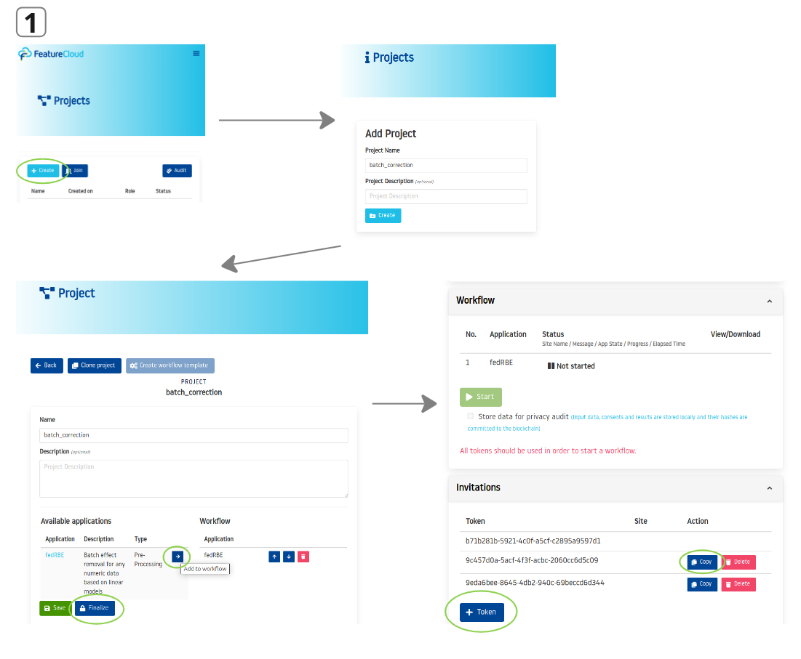
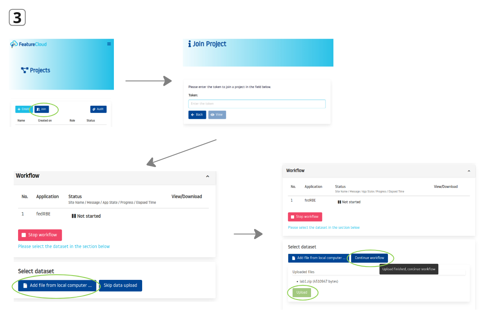

<table>
  <tr>
    <td><a href="https://freddsle.github.io/fedRBE/"></a></td>
    <td><a href="https://github.com/Freddsle/fedRBE/"></a></td>
    <td><a href="https://featurecloud.ai/app/fedrbe"></a></td>
  </tr>
</table>

# Getting started with federated limma remove batch effect (fedRBE) <!-- omit in toc -->

Use `fedRBE` to correct batch effects across sites without sharing raw data.
This guide covers setup and collaboration; see the
[app README](https://freddsle.github.io/fedRBE/batchcorrection/) for technical
details and the [preprint](https://doi.org/10.48550/arXiv.2412.05894) for the method.


## List of contents <!-- omit in toc -->

- [Minimal requirements and setup](#minimal-requirements-and-setup)
- [Understanding the workflow](#understanding-the-workflow)
- [File preparation](#file-preparation)
- [Step-by-step scenario](#step-by-step-scenario)
- [Results and output](#results-and-output)
- [Single-machine simulations using the provided sample data](#single-machine-simulations-using-the-provided-sample-data)
- [Troubleshooting tips](#troubleshooting-tips)
  - [Choosing the correct data orientation](#choosing-the-correct-data-orientation)
  - [Incorporating covariates](#incorporating-covariates)
  - [Selecting a reference batch](#selecting-a-reference-batch)


## Minimal requirements and setup

Install Docker, Python, and the CLI, then register:
1. **Docker**: [Installation Instructions](https://www.docker.com/get-started)
1. **Python 3.8+**: [Installation Instructions](https://www.python.org/)
1. **FeatureCloud CLI**:
   ```bash
   pip install featurecloud
   ```
1. **FeatureCloud account**: Register at [featurecloud.ai](https://featurecloud.ai/) and obtain coordinator/participant tokens.

For Windows users, we recommend using [WSL](https://docs.docker.com/desktop/features/wsl/).

## Understanding the workflow

1. **Coordinator creates a FeatureCloud project and distributes tokens** to at least 3 participants.
2. **Each Participant (Client)** prepares their data and a `config.yml` file.
3. **All Clients join the project** using FeatureCloud and run the app locally.
4. **fedRBE aligns and corrects batch effects** without sharing raw data.
5. **Each client receives its corrected data locally**.

## File preparation

Each client needs:
1. **Expression Data File** (CSV/TSV)
2. **`config.yml`** for custom settings
3. **Optional Design File** with covariates.

<p align="center">
   
</p>

**Minimal Example Directory Structure**:
```text
client_folder/
├─ config.yml
├─ expression_data.csv
├─ design.csv
```

For single-machine simulation, use at least three client folders (e.g., `clientA`,
`clientB`, `clientC`), each containing sample data and `config.yml`.

**Example `config.yml` snippet**:
```yaml
flimmaBatchCorrection:
  data_filename: "expression_data_client1.csv"
  expression_file_flag: True # True when features are rows and samples are columns
  index_col: "GeneIDs"  # Feature identifier column when expression_file_flag is true
  covariates: ["Pyr"]   # Covariates column name to include in the design matrix
  separator: ","  # Separator used in the data file
  design_separator: "," # Separator used in the design file
  normalizationMethod: "log2(x+1)"  # Normalization method or log transformation
  smpc: True  # Recommended to set to True
  min_samples: 5  # Minimum number of samples per batch to include a feature
  position: 1   # position of the client (first, second, third, etc.)
  reference_batch: ""  # Leave empty to use the last client in positional order as the reference
```

See the [full configuration reference](https://freddsle.github.io/fedRBE/batchcorrection/#configuration-configyml).

## Step-by-step scenario

**Scenario**: Three clients (A, B, and C) collaborate on a federated analysis. Video tutorial: [FeatureCloud tutorial](https://featurecloud.ai/researchers).

1. **Coordinator Actions**:  
   - Log into FeatureCloud, create a project, add fedRBE, and finalize the workflow.
   - Create tokens and send them to Clients A, B, and C.

   <p align="center">
   
   </p>
   
2. **Client Setup**:
   - Each client places `expression_data_client.csv` and `config.yml` in a local folder;
     set `data_filename` to the actual filename and adjust other settings as needed.
   - For multiple batches within a client, provide batch labels in `design.csv` and
     set `batch_col` to that column's name.
   
3. **Joining the Project**:
   - Each client logs into FeatureCloud and joins with its token.
   - Upload data and configuration to the local GUI as one ZIP with no nested
     folders. The files become available to the app's Docker container and stay
     local; they are not sent to the coordinator or other clients.

   <p align="center">
   
   </p>
   
4. **Running fedRBE**:
   - After all clients join, the coordinator starts the project.
   - The app runs locally at each client, securely combining results.
   
## Results and output

After completion, each client finds:
   - `only_batch_corrected_data.csv`: The batch-corrected expression data.
   - `report.txt`: Details on excluded features, beta values, and the used design matrix.
   - logs: Detailed logs of the process.
   

## Single-machine simulations using the provided sample data

Run the bundled sample experiment with multiple local clients using the
[Local Test Simulation](https://freddsle.github.io/fedRBE/docs/local_test.html) guide.


## Troubleshooting tips

- **Missing Files**: If you see "file not found," ensure that `config.yml` and data files are in the same directory.
- **Incorrect Format**: Check if `expression_file_flag` and `index_col` are set correctly based on your data orientation.
- **No Output Produced**: Review `report.txt` and logs. 
- **Errors with Test runs**: Ensure there are no leftover running Docker containers. Restart Docker or the system if necessary.

### Choosing the correct data orientation

Set `expression_file_flag` and `index_col` in `config.yml` to match the data:

- **If your file is features (rows) x samples (columns)**:  
  `expression_file_flag: True` and `index_col: <feature_id_column>`

- **If your file is samples (rows) x features (columns)**:  
  `expression_file_flag: False` and `index_col: <sample_id_column>`


### Incorporating covariates

Values must be numeric, complete and finite; encode categorical variables as
numeric indicator columns. See the app's
[input requirements](../batchcorrection/README.md#input-requirements) for design
rank, batch-label, finite-observation and SMPC configuration checks.

List model covariates (e.g., age or treatment) under `covariates`. Supply their
values in `design_filename`, or in the main data file if no separate design file
is provided: covariate rows for `expression_file_flag: True`, columns for `False`.
Without a design file, each client contains one batch; use `covariates: []` for
batch-only correction. Embedded covariates are excluded from corrected features
and retained unchanged in the output with covariates.

**Example:**
```yaml
covariates: ["Age", "Treatment"]
```

### Selecting a reference batch

Positions determine client order only when every client supplies an integer.
Otherwise fedRBE uses the coordinator's client order, which may vary between runs.
Without `reference_batch`, the last client's alphabetically last batch is the
reference. In coordinator order, an explicit reference moves its client to the end;
with integer positions, the reference client must already be last.

**Example:**
```yaml
position: 2
reference_batch: ""
```
